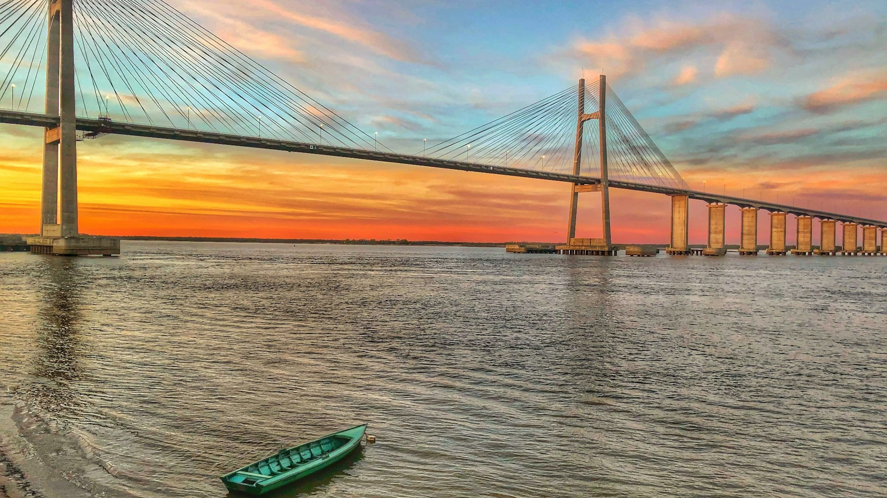
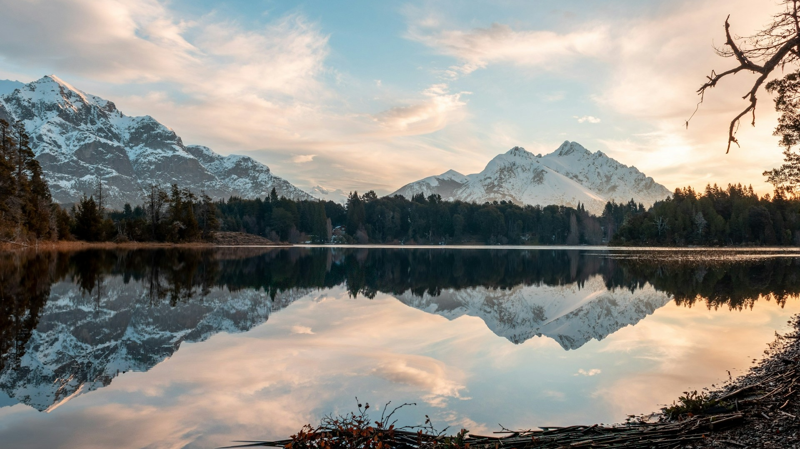
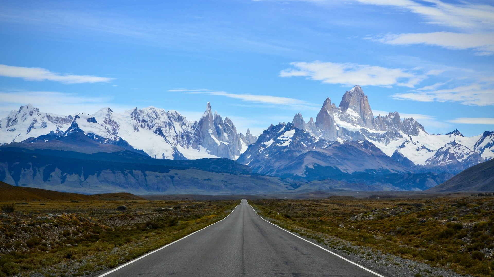
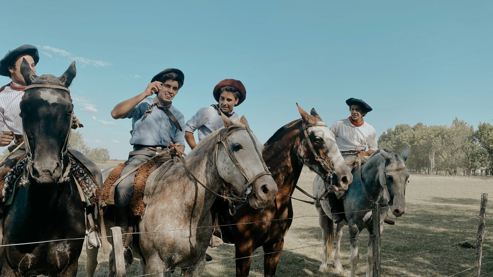
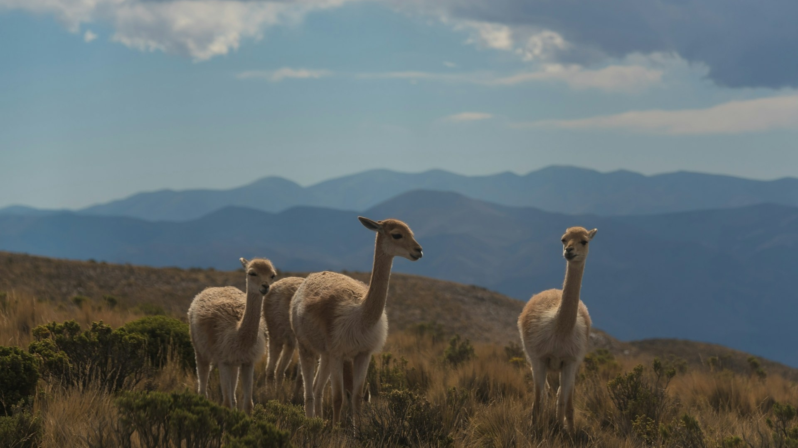
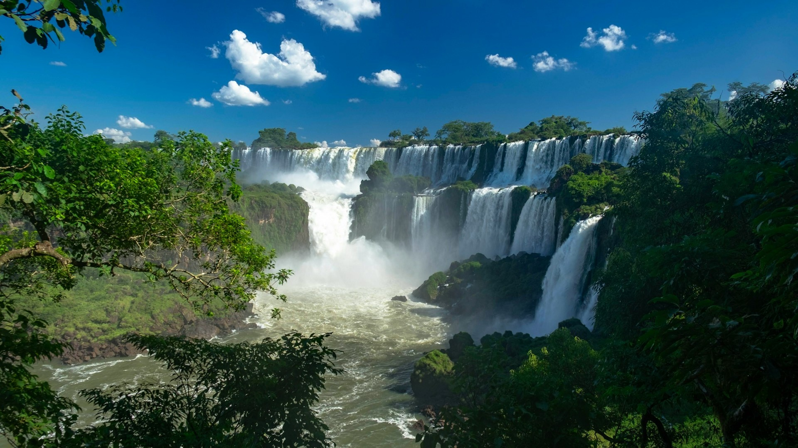
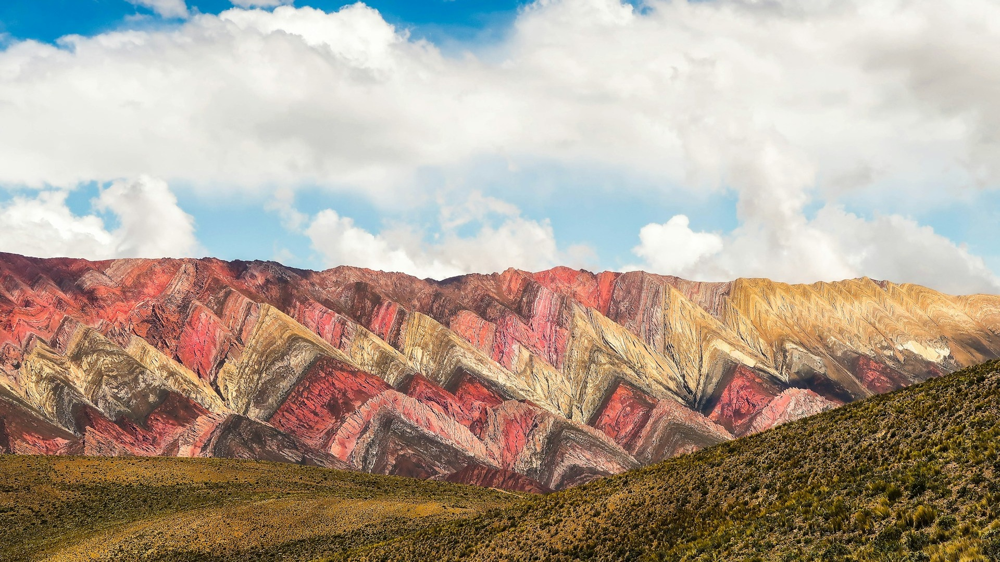
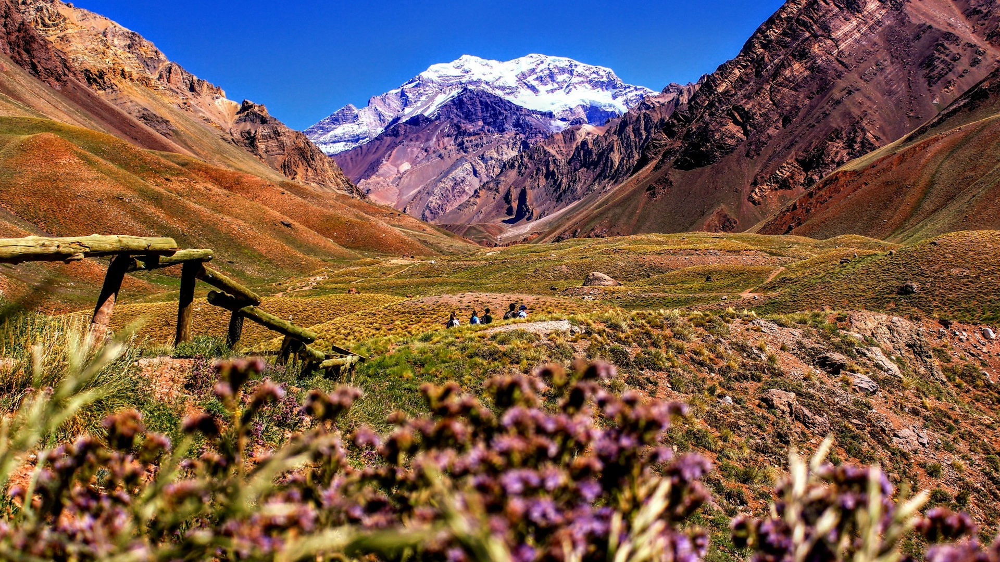

# Bootstrap Carousel for Quarto

This extension exposes [Bootstrap’s Carousel component](https://getbootstrap.com/docs/5.3/components/carousel/) for use in Quarto HTML documents with a Bootstrap theme. PDF output shows the images and their captions in order.

## Installation

```sh
quarto add tomicapretto/quarto-carousel
```

This command installs the extension under the `_extensions` directory.

If you are using version control, make sure to commit this directory.

## Usage

Include the following in your YAML front matter to activate the filter:

```yaml
filters:
  - carousel
```

Then, you can create (text based) carousels in the following way:

```markdown
:::: {.carousel}

:::: {.carousel-item}
Slide 1
:::

:::: {.carousel-item}
Slide 2

Multiple lines, too.
:::

:::: {.carousel-item}
Slide 3
:::

:::
```

Or image-based carousels like this:

```markdown
:::: {.carousel}

:::: {.carousel-item image="path/to/image.jpg"}
:::

:::: {.carousel-item image="path/to/image2.jpg"}
:::

:::: {.carousel-item image="path/to/image3.jpg"}
:::

:::
```

## Supported slide syntax

The existing `.carousel-item` syntax also accepts `.item` as an alias:

```markdown
::::: {.carousel .dark .framed autoplay="false"}
:::: {.item image="assets/imgs/puente-rosario_maximiliano-piu_cropped.jpg" caption="Visit Rosario.<br>Cross the river."}
::::
:::: {.item image="assets/imgs/bariloche_emilio-lujan_cropped.jpg" caption="Continue to Bariloche."}
::::
:::::
```

You can also put Markdown images directly inside `.carousel`. Their captions
become the slide captions. Images with figure identifiers are supported too:

```markdown
::: {.carousel .dark .framed}


{#fig-bariloche}
:::

See @fig-bariloche.
```

In static output, images use a native Pandoc image at `85%` width, followed by
the caption and any slide body content. Captions containing `<br>` become native
line breaks; inline HTML formatting such as `<strong>` is retained as native
formatting. CSS styling, controls and timing options apply to interactive HTML
output only. SVG images are also supported in Typst output.

## Example

[example.qmd](example.qmd) demonstrates the carousel options. Code blocks are
collapsed in HTML under “View code”. Render the HTML and PDF examples with:

```sh
quarto render
```

Or select a format:

```sh
quarto render example.qmd --to html
quarto render example.qmd --to typst
```

Outputs are written to `_site/example.html` and `_site/example.pdf`.

Published demo: [tomicapretto.com/quarto-carousel](https://tomicapretto.com/quarto-carousel/).

## Updating an existing project

```sh
quarto update tomicapretto/quarto-carousel
```

See [CHANGELOG.md](CHANGELOG.md) for version details.

## Validation

```sh
python3 tests/check.py
```

The integration check verifies HTML controls, figure references and copied
resources, plus native PDF images, captions and line breaks. It checks PDF text
when `pdftotext` is installed and uses a temporary SVG for image coverage.

## Photo Credits

<figure>
  
  <figcaption>
  Photo by <a href="https://unsplash.com/@polo_piu">Maximiliano Piu</a> on <a href="https://unsplash.com/photos/jon-boat-near-of-cable-bridge-wL7gpWwyjHs">Unsplash</a>
  </figcaption>
</figure>

<figure>
  
  <figcaption>
Photo by <a href="https://unsplash.com/@emilio_lujan">Emilio Luján</a> on <a href="https://unsplash.com/photos/lake-near-mountain-under-white-clouds-during-daytime-OKWAtnEfN4M">Unsplash</a>
  </figcaption>
</figure>


<figure>
  
  <figcaption>
Photo by <a href="https://unsplash.com/@nachoestevo">Ignacio Estevo</a> on <a href="https://unsplash.com/photos/gray-concrete-road-near-snow-covered-mountain-during-daytime-xAMfQn0tWoE">Unsplash</a>
  </figcaption>
</figure>


<figure>
  
  <figcaption>
Photo by <a href="https://unsplash.com/@nicolasmtaylor">Nicolas Taylor</a> on <a href="https://unsplash.com/photos/people-riding-horses-on-green-grass-field-during-daytime-ziXS8iTdeXE">Unsplash</a>
  </figcaption>
</figure>

<figure>
  
  <figcaption>
Photo by <a href="https://unsplash.com/@translytranslations">Transly Translation Agency</a> on <a href="https://unsplash.com/photos/three-beige-animals-on-brown-grass-field-ymGDEiGl6lA">Unsplash</a>
  </figcaption>
</figure>

<figure>
  
  <figcaption>
Photo by <a href="https://unsplash.com/@goosegrease">Derek Oyen</a> on <a href="https://unsplash.com/photos/trees-beside-waterfalls-lYv3hXpFdeY">Unsplash</a>
  </figcaption>
</figure>

<figure>
  
  <figcaption>
Photo by <a href="https://unsplash.com/@argentinanatural">Hector Ramon Perez</a> on <a href="https://unsplash.com/photos/brown-and-gray-mountains-under-white-clouds-and-blue-sky-during-daytime-e7D8evFSyww">Unsplash</a>
  </figcaption>
</figure>

<figure>
  
  <figcaption>
Photo by <a href="https://unsplash.com/@ni_coperez">Nicolas Perez</a> on <a href="https://unsplash.com/photos/purple-petaled-flowers-near-mountain-during-daytime-eNWcXCbE5fI">Unsplash</a>
  </figcaption>
</figure>

<figure>
  
  <figcaption>
Photo by <a href="https://unsplash.com/@luukski">Luuk Wouters</a> on <a href="https://unsplash.com/photos/red-and-white-lighthouse-near-body-of-water-F_zec7P_OwA">Unsplash</a>
  </figcaption>
</figure>


